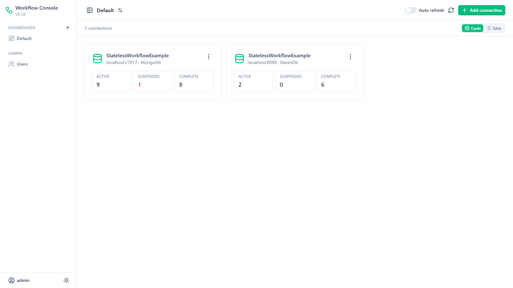
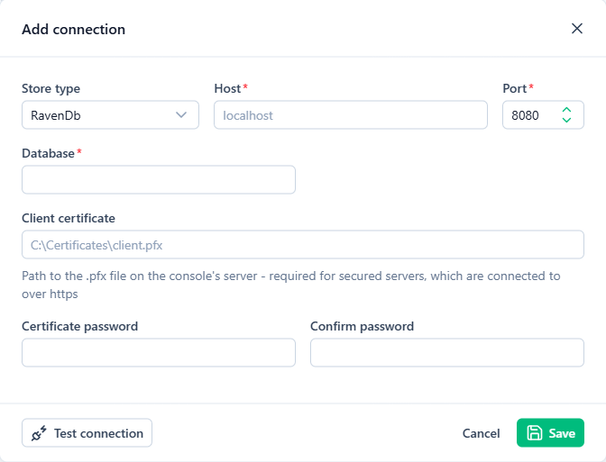
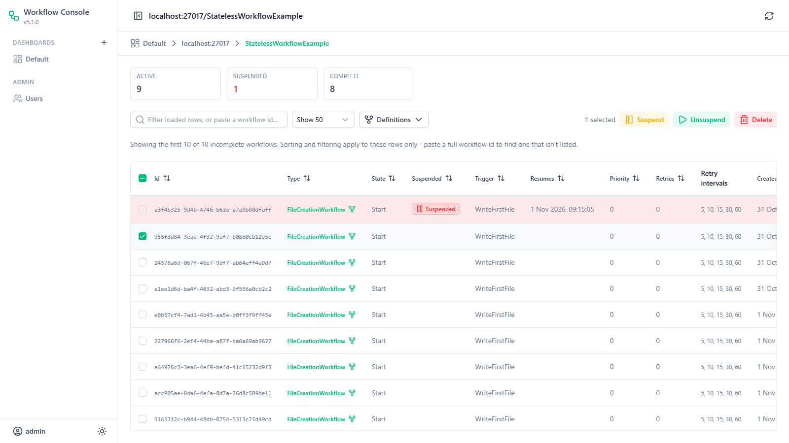
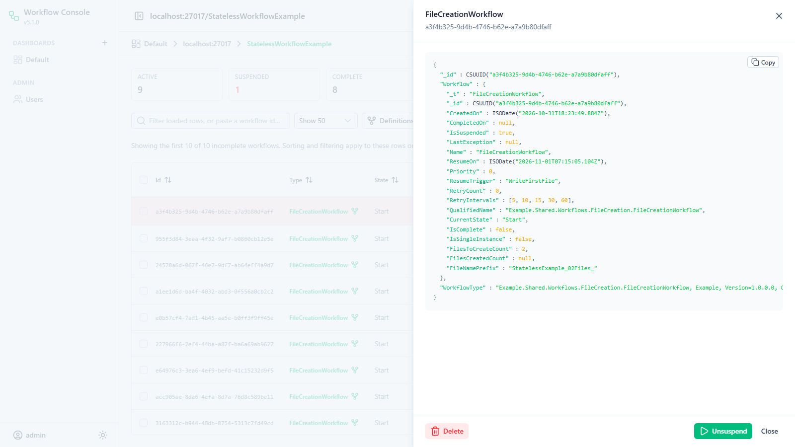
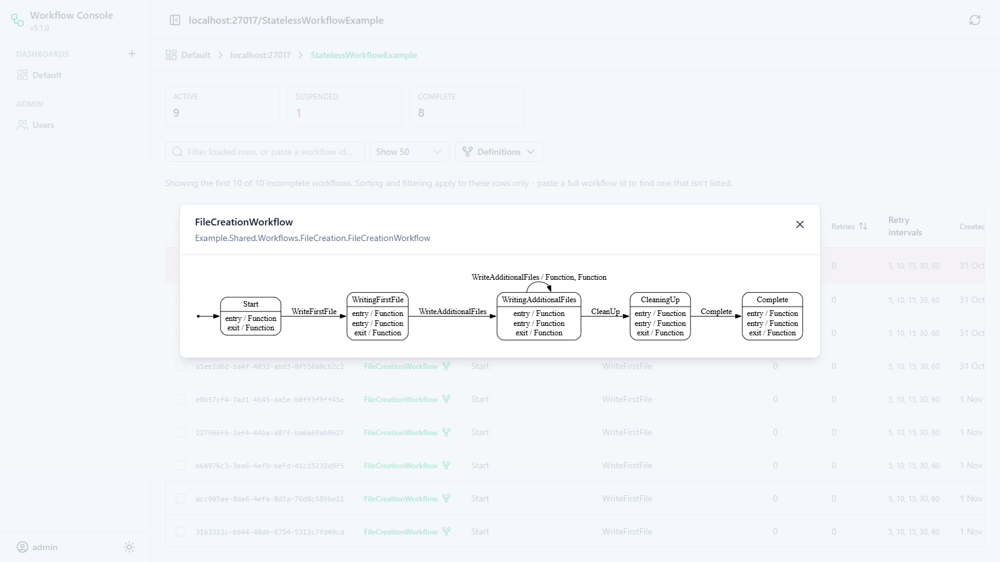
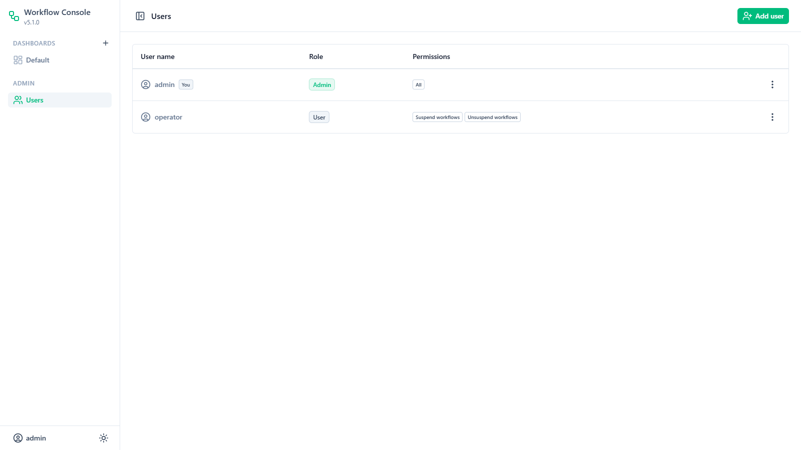

Stateless.Workflow
==================

Stateless.Workflow is a basic .NET workflow engine based on the awesome [stateless](https://github.com/nblumhardt/stateless) State Machine. It works in the same fashion as Stateless, but provides a wrapper for moving between states with the extra features expected of a workflow engine, such a retry attempts, exception handling, delays between workflow steps, etc.

[](https://ci.appveyor.com/project/mrsalmon1976/stateless-workflowengine)

# Persistence

The engine supports multiple data stores: 

 1. MemoryStore - this is an in-memory store: not particularly useful for most scenarios but it's good for testing, and could theoretically be used in an application wanting to take advantage of non-critical, simple workflowed steps in a background process.
 2. MongoDbStore - a store using a MongoDb database.
 3. RavenDb - a store using a RavenDb database.
 
All stores will use two collections: Workflows and CompletedWorkflows.  When a workflow is registered via the server or client, it is persisted in the Workflows collection.  The workflow will then move through various states until completion, in which case it will be moved to the CompletedWorkflows collection.  This store is never read by the workflow engine, it is purely for archiving purposes.

## Version Info

This table shows the client version and the associated driver/client versions used.

| Store     | Version   | Package        | Package Version |
|-----------|-----------|----------------|-----------------|
| MongoDb   | 2.6.0     | MongoDB.Driver | 2.13.2          |
|           | 3.0.0     | MongoDB.Driver | 2.19.0          |
|           | 3.1.0     | MongoDB.Driver | 2.21.0          |
|           | 4.0.0     | MongoDB.Driver | 2.26.0          |
|           | 5.0.0     | MongoDB.Driver | 2.30.0          |
|           | 6.0.0     | MongoDB.Driver | 3.13.0          |
| RavenDb   | 2.6.0     | RavenDB.Client | 3.5.7           |
|           | 3.0.0     | RavenDB.Client | 5.4.4           |
|           | 3.1.0     | RavenDB.Client | 5.4.109         |
|           | 4.0.0     | RavenDB.Client | 5.4.200         |
|           | 5.0.0     | RavenDB.Client | 7.2.1           |
|           | 5.1.0     | RavenDB.Client | 7.2.2           |
|           | 6.0.0     | RavenDB.Client | 7.2.7           |

From version 6.0, all packages target **.NET 10** (`net10.0`).  Version 5.x targeted .NET Standard 2.0 (and .NET Framework 4.8 for RavenDb) - applications running on .NET Framework should stay on 5.x.

Version 6.0 of the MongoDb store uses version 3 of the MongoDb driver, which requires **MongoDb Server 4.4 or later** - stay on 5.x for older servers.  Applications using the store must also use version 3 of the driver (see the [driver's upgrade guide](https://www.mongodb.com/docs/drivers/csharp/current/reference/upgrade/v3/) for any changes needed in your own MongoDb code), and existing workflows remain readable (see [Guids](#guids)).

# Workflow Configuration

Workflows are configured in a similar fashion to Stateless.  You should make an effort to understand how Stateless works before attempting to use this workflow engine.  All configuration should go into the `Initialise` override on the Workflow itself.  Extra properties can be added to your custom workflows, and these will be serialized with the workflow when it is persisted to the store. The Stateless concepts of State and Triggers remain the same, and are used by the workflow engine to move between actions in the workflow.

# Example  

There is a full example console application in the source code, in the `source/Example` folder (`dotnet run --project source/Example`).  This contains the following examples:

1. register workflows with an `IWorkflowClient` (MongoDb or RavenDb)
2. execute these workflows with an `IWorkflowServer`: each writes 10 files to the "C:\Temp" folder, then deletes all the files.  
3. create and execute 1000 workflows using async methods with contrived exceptions to show the retry mechanism of the engine
4. same as previous, except using sync methods 

The examples connect to MongoDb on `mongodb://localhost:27017` and RavenDb on `http://localhost:8080` - the containers started by `start.ps1` (see [Development](#development)).  These can be overridden with the `STATELESS_MONGODB_CONNECTIONSTRING` and `STATELESS_RAVENDB_URL` environment variables, or in `AppSettings.cs`.

# Getting Started

An application using the engine has two parts:

* a **WorkflowClient**, used wherever workflows are created (e.g. a web site or API) to register them in the workflow store
* a **WorkflowServer**, usually running as a Windows service, which picks up registered workflows and executes them

Both use the same workflow store, and need a reference to the assembly containing your workflow classes.  The steps below create a workflow that sends a welcome email, register it from your application, and run it from a Windows service.

## 1. Install the packages

Install the package for your workflow store (it includes the core `Stateless.WorkflowEngine` package):

```bash
dotnet add package Stateless.WorkflowEngine.MongoDb
# or
dotnet add package Stateless.WorkflowEngine.RavenDb
```

## 2. Create a workflow

A workflow is a class inheriting from `StateWorkflow<TState, TTrigger>`, which configures its [Stateless](https://github.com/dotnet-state-machine/stateless) states and triggers in `Initialise`.  Each step's work is done by a workflow action, and the action sets the `ResumeTrigger` - the trigger the server fires next.  The workflow is finished when `IsComplete` is set.

```csharp
using MongoDB.Bson.Serialization.Attributes;
using Stateless.WorkflowEngine;

[BsonIgnoreExtraElements]   // MongoDb only - see Serialisation
public class WelcomeEmailWorkflow : StateWorkflow<WelcomeEmailWorkflow.State, WelcomeEmailWorkflow.Trigger>
{
    public enum State { Start, SendingEmail, Complete }

    public enum Trigger { SendEmail, Complete }

    // the parameterless constructor is used when the workflow is loaded from the store
    public WelcomeEmailWorkflow() : base(State.Start, Trigger.SendEmail)
    {
    }

    // custom properties are saved with the workflow
    public string? EmailAddress { get; set; }

    public override void Initialise(string initialState)
    {
        base.Initialise(initialState);

        this.Configure(State.Start)
            .Permit(Trigger.SendEmail, State.SendingEmail);

        this.Configure(State.SendingEmail)
            .OnEntryAsync(async () => await this.ExecuteWorkflowActionAsync<SendWelcomeEmailAction>())
            .Permit(Trigger.Complete, State.Complete);

        this.Configure(State.Complete)
            .OnEntry(() => this.IsComplete = true);
    }
}
```

```csharp
public class SendWelcomeEmailAction : IWorkflowActionAsync
{
    private readonly IEmailSender _emailSender;

    public SendWelcomeEmailAction(IEmailSender emailSender)
    {
        _emailSender = emailSender;
    }

    public async Task ExecuteAsync(Workflow workflow, CancellationToken cancellationToken = default)
    {
        var wf = (WelcomeEmailWorkflow)workflow;
        await _emailSender.SendAsync(wf.EmailAddress!, "Welcome!", cancellationToken);

        // tell the server which trigger to fire next
        wf.ResumeTrigger = WelcomeEmailWorkflow.Trigger.Complete.ToString();
    }
}
```

If an action throws, the workflow stays in its current state and is retried after each of its `RetryIntervals` (5, 10, 15, 30 and 60 seconds by default).  If it still fails, the workflow is suspended until someone unsuspends it - e.g. in the [web console](#web-console).

## 3. Register workflows

Register a workflow with a `WorkflowClient` wherever it should start - it is saved to the store, and the server will pick it up:

```csharp
IWorkflowStore store = new MongoDbWorkflowStore(new MongoClient(connectionString).GetDatabase("MyApp"));
IWorkflowClient workflowClient = new WorkflowClient(store);

await workflowClient.RegisterAsync(new WelcomeEmailWorkflow { EmailAddress = user.EmailAddress });
```

## 4. Run the WorkflowServer as a Windows service

The easiest way to host the server is a .NET [Worker Service](https://learn.microsoft.com/dotnet/core/extensions/workers), which runs as a Windows service with a few lines of code (and as a normal console app when run directly, which is handy for development):

```bash
dotnet new worker -n MyWorkflowServer
cd MyWorkflowServer
dotnet add package Microsoft.Extensions.Hosting.WindowsServices
dotnet add package Stateless.WorkflowEngine.MongoDb
```

Add a reference to the project containing your workflows, and replace `Program.cs` with the following, which sets up the store and server as singletons and lets the server create workflow actions from the service provider (see [Dependency Injection](#dependency-injection)):

```csharp
using MongoDB.Driver;
using Stateless.WorkflowEngine;
using Stateless.WorkflowEngine.MongoDb;
using Stateless.WorkflowEngine.Stores;

var builder = Host.CreateApplicationBuilder(args);

// runs as a Windows service when installed as one, or as a console app when run directly
builder.Services.AddWindowsService(options => options.ServiceName = "MyWorkflowServer");

builder.Services.AddSingleton<IWorkflowStore>(sp =>
{
    var client = new MongoClient(builder.Configuration.GetConnectionString("Workflows"));
    return new MongoDbWorkflowStore(client.GetDatabase("MyApp"));
});

builder.Services.AddSingleton<IWorkflowServer>(sp =>
{
    var workflowServer = new WorkflowServer(sp.GetRequiredService<IWorkflowStore>());
    workflowServer.DependencyResolver = new ServiceProviderResolver(sp);

    // register each workflow type the server runs
    workflowServer.RegisterWorkflowType<WelcomeEmailWorkflow>();
    return workflowServer;
});

// workflow actions are created by the dependency resolver, so register them and their dependencies
builder.Services.AddTransient<SendWelcomeEmailAction>();
builder.Services.AddSingleton<IEmailSender, SmtpEmailSender>();

builder.Services.AddHostedService<WorkflowWorker>();

builder.Build().Run();
```

The worker polls the store for workflows until the service stops:

```csharp
using Stateless.WorkflowEngine;

public class WorkflowWorker : BackgroundService
{
    private readonly IWorkflowServer _workflowServer;
    private readonly ILogger<WorkflowWorker> _logger;

    public WorkflowWorker(IWorkflowServer workflowServer, ILogger<WorkflowWorker> logger)
    {
        _workflowServer = workflowServer;
        _logger = logger;
    }

    protected override async Task ExecuteAsync(CancellationToken stoppingToken)
    {
        _workflowServer.WorkflowCompleted += (sender, e) => _logger.LogInformation("Workflow {Id} completed", e.Workflow.Id);
        _workflowServer.WorkflowSuspended += (sender, e) => _logger.LogError("Workflow {Id} suspended: {Error}", e.Workflow.Id, e.Workflow.LastException);

        while (!stoppingToken.IsCancellationRequested)
        {
            try
            {
                // run up to 100 workflows, 10 at a time - if there was nothing to do, wait before polling again
                int executed = await _workflowServer.ExecuteWorkflowsAsync(100, 10, stoppingToken);
                if (executed == 0)
                {
                    await Task.Delay(TimeSpan.FromSeconds(5), stoppingToken);
                }
            }
            catch (OperationCanceledException) when (stoppingToken.IsCancellationRequested)
            {
                // the service is stopping
            }
            catch (Exception ex)
            {
                // e.g. the database is unavailable - keep the service running and try again
                _logger.LogError(ex, "Error executing workflows");
                await Task.Delay(TimeSpan.FromSeconds(30), stoppingToken);
            }
        }
    }
}

public class ServiceProviderResolver : IWorkflowEngineDependencyResolver
{
    private readonly IServiceProvider _serviceProvider;

    public ServiceProviderResolver(IServiceProvider serviceProvider)
    {
        _serviceProvider = serviceProvider;
    }

    public T GetInstance<T>() where T : class
    {
        return _serviceProvider.GetRequiredService<T>();
    }
}
```

Add the connection string to `appsettings.json`:

```json
{
  "ConnectionStrings": {
    "Workflows": "mongodb://localhost:27017"
  }
}
```

Run it with `dotnet run` to test it as a console app.  To install it as a Windows service, publish it and create the service from an elevated PowerShell prompt:

```powershell
dotnet publish -c Release -r win-x64 --self-contained false -o C:\Services\MyWorkflowServer
sc.exe create MyWorkflowServer binPath= "C:\Services\MyWorkflowServer\MyWorkflowServer.exe" start= delayed-auto
sc.exe failure MyWorkflowServer reset= 86400 actions= restart/60000/restart/60000/restart/60000
sc.exe start MyWorkflowServer
```

The `failure` command restarts the service if it crashes.  By default the service runs as LocalSystem - use `sc.exe config MyWorkflowServer obj= "DOMAIN\account" password= "..."` to run it as an account with access to your database and anything your actions use.  As a Windows service, `ILogger` warnings and errors are written to the Windows Event Log (Application log) - add a logging provider such as NLog or Serilog for log files.  To remove the service, run `sc.exe stop MyWorkflowServer` and `sc.exe delete MyWorkflowServer`.

Things to keep in mind:

* **Run one WorkflowServer per workflow store.**  Workflows are not locked while they execute, so two servers polling the same store could run the same workflow at the same time.  Use `maxConcurrent` to process more workflows in parallel instead.
* The `WorkflowServer` should be a **singleton** - its constructor initialises the store (creating tables and indexes if `WorkflowServerOptions` allows it).
* Call `RegisterWorkflowType<T>()` for every workflow type.  This registers the type with the store (required for MongoDb), and saves the workflow's definition so the web console can show its graph.
* Workflow actions are resolved from the root service provider, so register them as transient or singleton - not scoped.  To use scoped services (e.g. an Entity Framework `DbContext`), create a scope in the action with `IServiceScopeFactory`.
* Make actions safe to retry: if an action fails part-way through, it runs again from the start.
* When workflow classes change, deploy the new version to both the server and the applications that register workflows.  Workflows already in the store are loaded into the new class, so avoid renaming or removing states and triggers that existing workflows may be in.

# Code and Concepts

## Creating a WorkflowServer

You will need a WorkflowServer, usually running in the context of a windows service, in order to process workflows in your application - see [Getting Started](#getting-started) for a complete example.

Note that this should be implemented in your application as a singleton, to prevent continuous schema checks which will slow down your application.

### Workflow Server Options

The `IWorkflowServer` class takes a `WorkflowServerOptions` parameter, where the following options can be set:

- `AutoCreateTables` - for workflow stores where tables must be explicitly created, if set to `true` this option will result in the server creating the tables if they do not exist.  Defaults to `true`.
- `AutoCreateIndexes` - if set to `true` this option will result in the server creating basic indexes (see below for more details).  Defaults to `true`.
- `PersistWorkflowDefinitions` - if set to true, workflow definitions will be inspected and stored if possible.  Defaults to `true`.

### Executing a Single Workflow

`IWorkflowServer` provides both synchronous and asynchronous methods for executing a single workflow instance directly:

| Method | Description |
|--------|-------------|
| `void ExecuteWorkflow(Workflow workflow)` | Synchronous. Fires the workflow's current trigger and saves state. |
| `Task ExecuteWorkflowAsync(Workflow workflow, CancellationToken cancellationToken = default)` | Asynchronous equivalent. The cancellation token is forwarded through to the workflow's `FireAsync` call and into any `IWorkflowActionAsync` actions. |

You would typically use these methods only when you have a specific workflow instance already in hand (e.g. in tests or when reprocessing a suspended workflow). The batch methods below are the normal production path.

### Executing Workflows in Bulk

`IWorkflowServer` provides batch execution methods that load workflows from the store and execute them, with optional concurrency control:

| Method | Description |
|--------|-------------|
| `int ExecuteWorkflows(int count, int? maxConcurrent = null)` | Synchronous. Loads up to `count` workflows and executes them using `Parallel.ForEach`, with no more than `maxConcurrent` running at once. |
| `Task<int> ExecuteWorkflowsAsync(int count, int? maxConcurrent = null, CancellationToken? cancellationToken = null)` | Asynchronous. Loads up to `count` workflows and executes them using a `SemaphoreSlim` to cap concurrency at `maxConcurrent`. Supports cancellation — already-dispatched tasks run to completion before the method returns. |

Both methods load workflows ordered by **Priority DESC**, then **CreatedOn ASC**.

The following code loads up to 100 workflows and processes them 10 at a time:

```csharp
int workflowsExecuted = await _workflowServer.ExecuteWorkflowsAsync(100, 10);
```

The return value is the number of workflows actually dispatched. If there were only 20 active workflows ready to run it returns 20; if there were more than 100 it caps at 100. This is useful for deciding whether to sleep or loop immediately:

```csharp
while (true)
{
    int executed = await _workflowServer.ExecuteWorkflowsAsync(100, 10, cancellationToken);
    if (executed == 0)
        await Task.Delay(TimeSpan.FromSeconds(1), cancellationToken);
}
```

#### Cancellation

`ExecuteWorkflowsAsync` accepts a `CancellationToken`. Cancelling it stops new workflows from being dispatched but allows any already-running workflows to finish cleanly. The token is also forwarded into each `ExecuteWorkflowAsync` call, and from there into `workflow.FireAsync` and any `IWorkflowActionAsync` actions, so long-running async actions can observe it directly.

## Creating a WorkflowClient

A WorkflowClient is used to register workflows for processing by the WorkflowServer - see [Getting Started](#getting-started).  It can also check on and manage workflows that have been registered (each method has an async equivalent):

```csharp
workflowClient.Register(workflow);                                // save a new workflow for the server to run
bool exists = workflowClient.Exists(workflowId);                  // false once the workflow has completed
MyWorkflow wf = workflowClient.Get<MyWorkflow>(workflowId);       // load an incomplete workflow
workflowClient.Unsuspend(workflowId);                             // retry a suspended workflow
workflowClient.Delete(workflowId);                                // remove an incomplete workflow
long suspended = workflowClient.GetSuspendedCount();              // also GetIncompleteCount() and GetCompletedCount()
```

Like the server, the client should be created once and reused.

## Workflow Actions

Each step of a workflow is implemented as an action class. There are two variants depending on whether the work is synchronous or asynchronous.

### Synchronous Actions

Implement `IWorkflowAction` and its `Execute(Workflow workflow)` method. Wire it up in your workflow's `Initialise` method using `OnEntry` and `ExecuteWorkflowAction<T>()`:

```csharp
public interface IWorkflowAction
{
    void Execute(Workflow workflow);
}
```

```csharp
// In your Workflow.Initialise():
this.Configure(State.WritingFirstFile)
    .OnEntry(() => this.ExecuteWorkflowAction<WriteFirstFileAction>())
    .Permit(Trigger.WriteAdditionalFiles, State.WritingAdditionalFiles);
```

```csharp
public class WriteFirstFileAction : IWorkflowAction
{
    public void Execute(Workflow workflow)
    {
        var wf = (FileCreationWorkflow)workflow;
        // do synchronous work...
        wf.ResumeTrigger = FileCreationWorkflow.Trigger.WriteAdditionalFiles.ToString();
    }
}
```

### Asynchronous Actions

Implement `IWorkflowActionAsync` and its `ExecuteAsync(Workflow workflow, CancellationToken cancellationToken)` method. Wire it up using `OnEntryAsync` and `ExecuteWorkflowActionAsync<T>()`:

```csharp
public interface IWorkflowActionAsync
{
    Task ExecuteAsync(Workflow workflow, CancellationToken cancellationToken = default);
}
```

```csharp
// In your Workflow.Initialise():
this.Configure(State.MarkingRecordAsProcessed)
    .OnEntryAsync(async () => await this.ExecuteWorkflowActionAsync<MarkRecordAsProcessedAsyncAction>())
    .Permit(Trigger.Complete, State.Complete);
```

```csharp
public class MarkRecordAsProcessedAsyncAction : IWorkflowActionAsync
{
    public async Task ExecuteAsync(Workflow workflow, CancellationToken cancellationToken = default)
    {
        var wf = (VolumeAsyncWorkflow)workflow;
        // await async work...
        wf.ResumeTrigger = VolumeAsyncWorkflow.Trigger.Complete.ToString();
    }
}
```

The `CancellationToken` passed to `ExecuteWorkflowActionAsync<T>` flows from `WorkflowServer.ExecuteWorkflowsAsync`, so if the server's token is cancelled your action can observe it and stop cleanly.

### Action Hooks

Both sync and async paths provide hook methods on the `Workflow` base class that you can override for logging or instrumentation:

| Sync | Async | Fires |
|------|-------|-------|
| `OnActionExecuting(IWorkflowAction action)` | `OnActionExecutingAsync(IWorkflowActionAsync action, CancellationToken ct)` | Before the action executes |
| `OnActionExecuted(IWorkflowAction action)` | `OnActionExecutedAsync(IWorkflowActionAsync action, CancellationToken ct)` | After the action executes |

### Choosing Sync vs Async

Use `IWorkflowActionAsync` whenever the action performs I/O (database queries, HTTP calls, file operations). Use `IWorkflowAction` for CPU-bound or trivially fast work. Mixing both in the same workflow is fine — each state entry independently chooses its variant.

## Workflow Priority

The workflow engine will process workflows in the order that they come in.  If a workflow fails, it will go to the back of the line, but will still get processed in date order.  In some cases, you may want particular workflows within a single workflow collection to be processed as a higher priority.  

For example, you may have an email handler that processes emails, but when users register they should be sent an email immediately.  In this case, you may want to prioritise registration emails over any other emails.

To cater for this, workflows have a "Priority" property that can be set.  This defaults to 0, but the higher the value, the more important the workflow is.  Workflows will get processed in order of priority (descending) before date.

## Dependency Injection

Most of the classes in the code implement an interface, which allows for the inversion of control.  One exception to this is 
the **_Workflow_** class, which needed to be concrete class.  This class contains the method to create a workflow action, using 
Activator.CreateInstance() which isn't great for DI.  For this purpose, the class provides the 

```csharp
CreateWorkflowActionInstance<T>()
```

method which can be overridden if you want to take control over how workflow actions are instantiated.

As of version 1.3.0, however, there is a better option.  The `WorkflowServer` class (required for the execution of workflows), has a `DependencyResolver` property, that implements the `IWorkflowEngineDependencyResolver` interface.  This can be set as part of your application's bootstrapping process:

```csharp
MyDependencyResolver resolver = new MyDependencyResolver();
workflowServer.DependencyResolver = resolver;
```

The interface has one method: `T GetInstance<T>` - which allows you to use your own DI framework to instantiate the action class.

With `Microsoft.Extensions.DependencyInjection`, pass the service provider to the resolver when the server is created (see [Getting Started](#getting-started) for a complete example), and register your action classes and their dependencies:

```csharp
services.AddSingleton<IWorkflowServer>((sp) => 
{
    var workflowServer = new WorkflowServer(sp.GetRequiredService<IWorkflowStore>());
    workflowServer.DependencyResolver = new MyResolver(sp);
    return workflowServer;
});
services.AddTransient<MyWorkflowAction>();
```

Your resolver would look like this:

```csharp
private class MyResolver : IWorkflowEngineDependencyResolver
{
  private readonly IServiceProvider _serviceProvider;

  public MyResolver(IServiceProvider serviceProvider)
  {
    this._serviceProvider = serviceProvider;
  }

  public T GetInstance<T>() where T : class
  {
    var result = _serviceProvider.GetService<T>();
    if (result == null)
    {
      throw new Exception("Class " + typeof(T).ToString() + " has not been registered with the container");
    }
    return result;
  }
}
```
## Events

Workflows move through states, but there are also events that occur in the lifecycle that are raised, allowing you to take 
action.

### WorkflowServer

The `IWorkflowServer` interface exposes two events:

1.` WorkflowSuspended` - this event is raised by the WorkflowServer when a workflow suspends.  This means that a workflow has errored repeatedly until the maximum number of retries (RetryCount) defined for the workflow has been exceeded.  The workflow goes into a suspended state and will not be picked up again by the WorkflowEngine until the problems have been resolved.  
2. `WorkflowCompleted` - this event is raised when a workflow completes.  The event is fired AFTER the workflow is archived and the workflow.OnComplete() method is called.  

### Workflow

When you implement your `Workflow` classes, you can also override the following event handlers:

1. `OnActionExecuting(IWorkflowAction action)` - Invoked before a synchronous workflow action executes. Useful for logging.
2. `OnActionExecutingAsync(IWorkflowActionAsync action, CancellationToken ct)` - Async equivalent, invoked before an async workflow action executes.
3. `OnActionExecuted(IWorkflowAction action)` - Invoked after a synchronous workflow action executes. Useful for logging.
4. `OnActionExecutedAsync(IWorkflowActionAsync action, CancellationToken ct)` - Async equivalent, invoked after an async workflow action executes.
5. `OnComplete` - Invoked when a workflow completes and is moved into the CompletedWorkflows collection.
6. `OnError` - Invoked when an error occurs within a workflow action. Useful for error logging.
7. `OnSuspend` - Invoked when a workflow has exceeded its configured retries, and moves into a suspended state.

## Single Instance Workflows

The engine supports the concept of a "Single Instance" workflows, which means there can only ever be one workflow of this type.  If you try to register a single instance workflow and one already exists, and exception will be thrown by the engine.

You would usually only register single instance workflows on application start up.  Both `IWorkflowClient` and `IWorkflowServer` expose methods to check if an instance exists already.  Example code would look like this:

```csharp
if (!_workflowServer.IsSingleInstanceWorkflowRegistered<MyWorkflow>()) 
{
  _workflowServer.RegisterWorkflowType<MyWorkflow>();
}
```

# Workflow Stores

## Indexing on data stores

Over time, workflow collections grow, and the CompletedWorkflows data store can get very large.  By default, instantiation of the WorkflowServer class will call the Initialise() method on the WorkflowStore being used, which will create the necessary tables/collections and indexes.  This behavior can be removed by setting the relevant values on the WorkflowServerOptions parameter on the constructor

## Default Indexes

### MongoDb

The following indexes are created by default:

* Workflows: Priority descending, RetryCount descending, CreatedOn ascending
* Workflows: IsSuspended - a partial index containing only suspended workflows, used for suspended and active counts
* CompletedWorkflows: CreatedOn descending

The active workflow count (`GetActiveCount`) is calculated as the estimated size of the Workflows collection less the suspended count, rather than by scanning the collection.  Like the incomplete and completed counts, it is an estimate - it can be slightly out after an unclean shutdown or when orphaned documents exist in a sharded cluster.

### RavenDb

No indexes are created - `Initialise()` only creates the database.  The store uses dynamic queries, which RavenDB always answers from **auto indexes**: it creates one for each query shape the first time it runs (e.g. `Auto/RavenWorkflows/ByWorkflow.IsSuspended`), and keeps it up to date from then on.  Note that on an existing large database, results from a newly created auto index can be incomplete until RavenDB has finished building it.

Versions prior to 6.0 deployed two static indexes, `WorkflowIndex/Priority/RetryCount/CreatedOn` and `CompletedWorkflowIndex/CreatedOn`.  No query ever used them, so they only added indexing and storage overhead.  They are no longer created, and existing copies can safely be deleted from the database in the RavenDB Studio (Indexes > List of Indexes).

## Manually creating indexes: MongoDb

On the CompletedWorkflows collection:

```csharp
db.CompletedWorkflows.createIndex({ "Workflow.CreatedOn" : -1 }, { name : "CompletedWorkflow_CreatedOn" })
```

On the Workflows collection (only create this if you generate a lot of workflows - usually your active workflow count should stay low so an index is not necessary):

```csharp
db.Workflows.createIndex({ "Workflow.Priority" : -1, "Workflow.RetryCount" : -1, "Workflow.CreatedOn" : 1 }, { name : "Workflow_Priority_RetryCount_CreatedOn" })
```

On the Workflows collection, a small partial index of suspended workflows (recommended - it keeps suspended and active counts fast, which the web console requests on every dashboard load):

```csharp
db.Workflows.createIndex({ "Workflow.IsSuspended" : 1 }, { name : "Workflow_IsSuspended", partialFilterExpression : { "Workflow.IsSuspended" : true } })
```

## Serialisation

### MongoDb

By default, when a class is deserialised, an exception will be thrown if a property exists on the document that is not declared on a workflow.  This can cause dependency issues in a distributed system - if one service registers a workflow and another service executes that workflow, if the definition changes you will need to deploy both services.  This gets particularly problematic when a workflow uses a class as a property that is used in multiple places.

To remove this dependency, you can add the following attribute to your workflow class definition to fix it on only your worklow.  Note that child classes will also need this attribute.

```csharp
[MongoDB.Bson.Serialization.Attributes.BsonIgnoreExtraElements]
```

Alternatively, you can fix it globally in application start-up:

```csharp
ConventionRegistry.Register(
    "IgnoreExtraElements",
    new ConventionPack { new IgnoreExtraElementsConvention(true) },
    type => true);
```
Note that like all things, this comes with its own risks - the engine will no longer fail to load a document with a property it does not recognise, but you will lose this data when it is written back to the document store after execution.

#### Guids

Version 3 of the MongoDb driver (used from version 6.0 of the store) requires the Guid format to be configured.  Earlier versions of the store saved Guids in the C# legacy format (binary subtype 3), so the store configures workflow and workflow definition ids to use that format - existing workflows can be read without any changes.

**If your workflow classes have their own `Guid` properties**, register a Guid serializer at application start-up, *before* creating a `MongoClient` or using the store:

```csharp
BsonSerializer.RegisterSerializer(new GuidSerializer(GuidRepresentation.CSharpLegacy));
```

Without this, the driver will throw an exception when saving or loading those workflows (`GuidSerializer cannot serialize a Guid when GuidRepresentation is Unspecified`).  Use `CSharpLegacy` to keep reading workflows saved by earlier versions - only use another representation (such as `Standard`) for a new store with no existing data, as Guids saved in different formats do not match each other in queries.

# Workflow Definitions


The `IWorkflowServer` will attempt to persist workflow definitions into a `WorkflowDefinitions` collection or table when types are registered.  These will result in graphs that can be rendered in the [web console](#web-console) displaying a representation of the workflow.  This option can be turned off using the `WorkflowOptions` property.

# Web Console

The web console is a browser-based tool for monitoring and managing workflow stores.  It is an ASP.NET Core (.NET 10) application that serves a Vue / Nuxt UI single page app, and runs as a Windows service or a Docker container.  It supports **MongoDb** (MongoDb Server 4.4 or later) and **RavenDb** stores.

Features:

* Dashboards of connections to workflow stores, showing active, suspended and completed workflow counts (with optional auto refresh)
* A list of incomplete workflows per store - view the workflow JSON, view the workflow definition graph, and suspend, unsuspend or delete workflows individually or in bulk
* User management with Admin and User roles - Users can be granted individual permissions
* A notification when a new version of the console is available

See [Installing as a Windows service](#installing-as-a-windows-service) or [Running in Docker](#running-in-docker) to get started, then sign in with **admin / admin** and change the password (user menu, bottom left > **Change password**).

## Dashboards



The dashboard shows a card for each connection, with its active, suspended and completed workflow counts.  Suspended workflows are highlighted in red, and a connection that can't be reached shows the error instead of its counts.  Switch to **Table** for a compact view of many connections, and turn on **Auto refresh** to keep the counts up to date.  Click a connection to see its workflows.

Connections are grouped into dashboards (e.g. one per environment or team), listed on the left - use **+** to add a dashboard, and the settings icon next to its name to rename or delete it.  There is always a **Default** dashboard, which can be renamed but not deleted.  A connection's menu (**⋮**) has options to edit it, delete it, or copy it to another dashboard.

## Connections

Click **Add connection** to connect to a workflow store, and **Test connection** to check the settings before saving them.  Passwords are encrypted (see [Configuration](#configuration)), and are never sent back to the browser - leave the password blank when editing a connection to keep the existing one.

**MongoDb** connections need the host, port (default 27017), database and the names of the active and completed workflow collections (`Workflows` and `CompletedWorkflows` unless your application changed them).  Optionally set a user and password, a replica set, and the workflow definition collection (default `WorkflowDefinitions`).

**RavenDb** connections need the host, port (default 8080) and database - the collections are fixed by the store, so they are not configured.



To connect to a secured RavenDb server, which uses https and authenticates with a client certificate, set **Client certificate** to the path of the certificate (`.pfx`) file on the console's server, and **Certificate password** to its password (if any).  In Docker, put the certificate in the `/app/Data` volume, e.g. `/app/Data/certs/client.pfx`.

The console doesn't have your workflow types loaded, so it works with the raw workflow documents.  Versions of the RavenDb store prior to 6.0 loaded the workflow type to suspend, unsuspend and delete a workflow - from 6.0 these patch or delete the document directly, as the MongoDb store does.

## Workflows



The workflow list shows the incomplete workflows in a store - completed workflows are not shown.  Suspended workflows are highlighted, and can be sorted to the top with the **Suspended** column.

* **Show** sets how many workflows are loaded (up to 1000) - sorting and filtering apply to the loaded rows only.  To find a specific workflow in a large store, paste its full id into the filter and it will be looked up directly.
* Select workflows with the checkboxes to **Suspend**, **Unsuspend** or **Delete** them in bulk.  Unsuspending a workflow resets its retry count, so it is picked up by the server straight away.
* Click a workflow's row to see its full JSON document, which can be copied, and to suspend, unsuspend or delete it.



* Click a workflow's type (or use **Definitions**) to see its state machine graph.  Graphs are only available for workflows whose definitions are saved to the store - see [Workflow Definitions](#workflow-definitions).



## Users and permissions



Admins can do everything, including managing users.  Users can view all dashboards and workflows, and can be granted individual permissions to:

* add, edit and delete connections
* add, rename and delete dashboards
* suspend, unsuspend and delete workflows
* view, add, edit and delete users

Actions a user doesn't have permission for are hidden.  Every user can change their own password from the user menu.

## Installing as a Windows service

1. Install the [ASP.NET Core 10 runtime (Hosting Bundle)](https://dotnet.microsoft.com/download/dotnet/10.0) on the server
2. Download `Stateless.WorkflowEngine.WebConsole_v{version}.zip` from the [latest release](https://github.com/mrsalmon1976/Stateless.WorkflowEngine/releases/latest) and unzip it into the install folder
3. In an elevated PowerShell prompt in the install folder, run `.\install-service.ps1` (use `.\install-service.ps1 -Uninstall` to remove the service)
4. Browse to `http://localhost:8811` and sign in with **admin / admin** - change this password immediately

## Configuration

Settings are in `appsettings.json`.  To override them, create an `appsettings.Production.json` in the install folder - this file is preserved when upgrading.

| Setting | Default | Description |
|---------|---------|-------------|
| `Urls` | `http://localhost:8811` | The url(s) the console listens on.  Use e.g. `http://*:8811` to allow access from other machines |
| `DataPath` | `Data` | Folder for users, connections and encryption keys (relative to the install folder) |
| `LatestVersionUrl` | GitHub releases API | Used to check for new versions |
| `UpdateCheckIntervalInMinutes` | `60` | How long the version check is cached for |

Users and connections are stored in `Data\users.json`.  Connection passwords are encrypted with ASP.NET Core Data Protection, with the keys stored in `Data\keys` - back up the whole `Data` folder, as connection passwords can't be decrypted without the keys.

## Upgrading

The console shows a banner when a new version is available, but upgrades are run manually: in an elevated PowerShell prompt in the install folder, run `.\Update.ps1`.  This downloads the latest release, backs up the current install to `Backup\{version}`, and replaces the application files, keeping `Data`, `logs` and `appsettings.Production.json`.

**Upgrading from version 5.x or earlier** (the .NET Framework console):

* Install the ASP.NET Core 10 runtime first
* Back up `Data\users.json`
* Copy `Update.ps1` from the new release zip over the old one before running it - the old script can't install the new service
* Existing users and connections are kept.  Saved connection passwords are re-encrypted on first start, after which the old console can no longer read them

## Running in Docker

```bash
docker build -f source/Stateless.WorkflowEngine.WebConsole/Dockerfile -t stateless-workflowengine-webconsole source
docker run -d -p 8811:8080 -v webconsole_data:/app/Data stateless-workflowengine-webconsole
```

The `/app/Data` volume holds users, connections and the encryption keys, so it must be persisted.  Settings can be overridden with environment variables, e.g. `-e LatestVersionUrl=...`.  Note that inside a container, `localhost` refers to the container itself - connect to MongoDb or RavenDb using a host name reachable from the container.

## Performance on large stores

Each dashboard load (and auto refresh) requests the workflow counts for every connection.  On MongoDb these use collection metadata and the partial `Workflow_IsSuspended` index (see [Default Indexes](#default-indexes)), so make sure that index exists on large stores.  On RavenDb they use auto indexes, which RavenDB creates on the first request (see [Default Indexes](#default-indexes)) - on a large existing database the counts can be incomplete until it has finished building them.

# Development

`start.ps1` in the repository root starts a local environment in Docker (starting Docker Desktop if necessary):

* MongoDb on `mongodb://localhost:27017`
* RavenDb on `http://localhost:8080` (an unsecured development instance)
* The web console on `http://localhost:8811`, built from source, with connections to the example MongoDb and RavenDb databases

```powershell
.\start.ps1            # start everything, rebuilding the console image
.\start.ps1 -NoBuild   # start without rebuilding the console image
.\start.ps1 -Stop      # stop the containers (data volumes are kept)
```

The example application and the MongoDb/RavenDb test projects use these containers by default.  Tests that need a database are marked with the `RequiresMongoDb` and `RequiresRavenDb` categories.

Every project targets .NET 10, so the solution builds and tests with the .NET 10 SDK alone:

```powershell
dotnet build source\Stateless.WorkflowEngine.sln
dotnet test source\Stateless.WorkflowEngine.sln     # needs start.ps1 running for the database tests
dotnet test source\Stateless.WorkflowEngine.sln --filter "TestCategory!=RequiresMongoDb&TestCategory!=RequiresRavenDb"   # no databases needed
```

To work on the web console with hot reload, run the API and the Vite dev server (which proxies `/api` calls to the API):

```powershell
dotnet run --project source\Stateless.WorkflowEngine.WebConsole        # http://localhost:8811
cd source\Stateless.WorkflowEngine.WebConsole.Client; npm install; npm run dev   # http://localhost:5173
```

Building a release (`deployment\build.ps1`) requires the .NET 10 SDK and Node.js, as publishing the console builds the client app.
